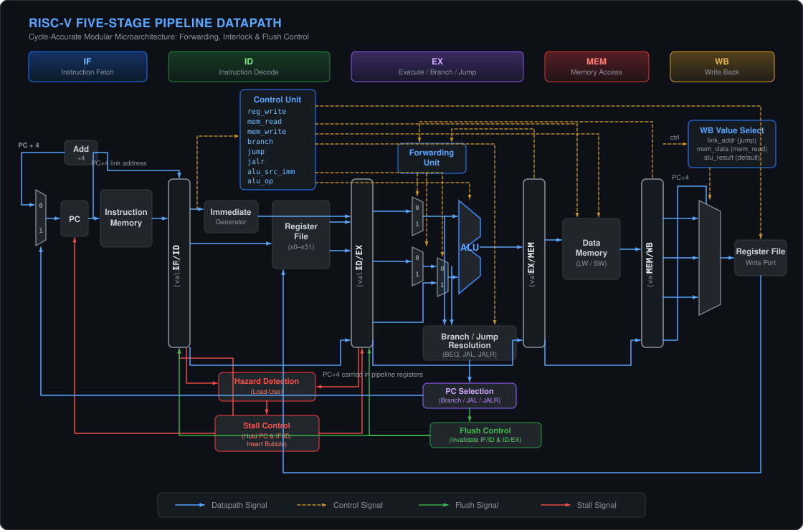
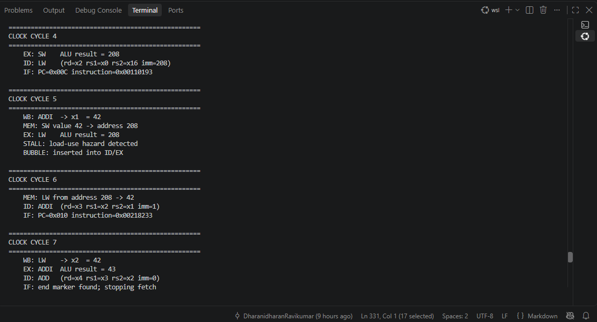
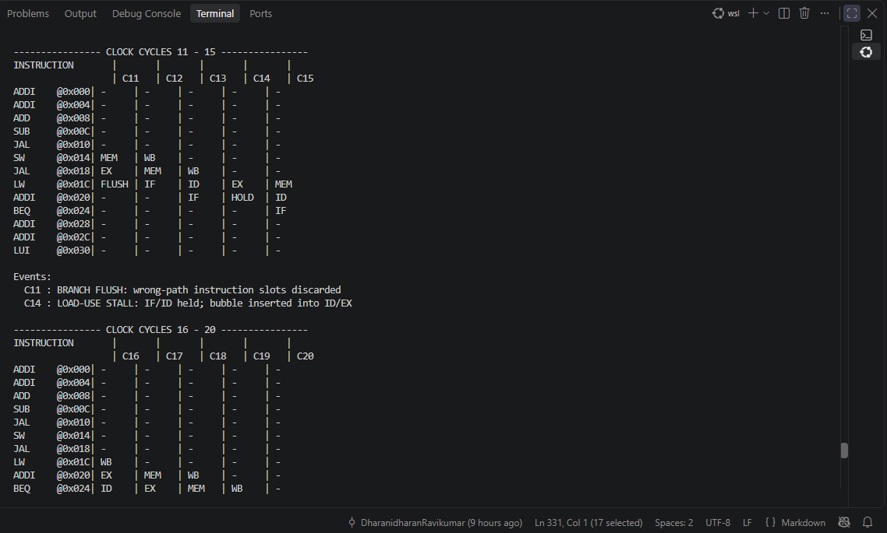

# RISC-V Five-Stage Pipeline Simulator (C)

[](https://en.wikipedia.org/wiki/C_(programming_language))
[](https://en.wikipedia.org/wiki/C11_(C_standard_revision))
[](https://riscv.org/)
[](#)

A cycle-accurate, educational RISC-V (RV32I subset) five-stage pipeline processor simulator written in standard C11. It models the classic **IF (Instruction Fetch)**, **ID (Instruction Decode)**, **EX (Execute)**, **MEM (Memory Access)**, and **WB (Write Back)** stages with support for data forwarding, load-use hazard stalling with bubble insertion, and EX-stage branch/jump resolution with wrong-path pipeline flushing.

---

## Contents

- [Overview & Datapath Architecture](#overview--datapath-architecture)
- [Architectural Overview of the 5-Stage Pipeline](#architectural-overview-of-the-5-stage-pipeline)
- [Project-Specific Datapath Diagram](#project-specific-datapath-diagram)
- [Supported Instruction Subset](#supported-instruction-subset)
- [Control Signal Design & Architectural Decisions](#control-signal-design--architectural-decisions)
- [Implementation Highlights & Hardware Mechanics](#implementation-highlights--hardware-mechanics)
- [Performance Instrumentation & Execution Views](#performance-instrumentation--execution-views)
- [Benchmark Suite](#benchmark-suite)
- [Sample Execution Outputs & Terminal Views](#sample-execution-outputs--terminal-views)
- [Modular Project Structure](#modular-project-structure)
- [Build & Run Instructions](#build--run-instructions)
- [Current Limitations & Scope](#current-limitations--scope)
- [Author](#author)

---

## Overview & Datapath Architecture

This simulator provides an observable, software-based model of a classic five-stage RISC-V in-order processor datapath. Developed to bridge the gap between abstract computer architecture theory and concrete software implementation, the project faithfully models cycle-by-cycle clock transitions, pipeline register staging, hazard detection interlocks, priority-based forwarding paths, and retired instruction metrics.

### Key Characteristics
- **Modular Architecture**: Clean separation between CPU state, decoder, ALU execution, hazard/forwarding logic, memory operations, write-back commit, and timeline instrumentation.
- **Hardware-Accurate Clock Stepping**: Uses an explicit old-state / next-state synchronization barrier to guarantee that instructions advance strictly one stage per clock cycle.
- **Cycle-by-Cycle Pipeline Timeline**: Built-in ASCII visualizer tracking instructions through each stage alongside stall and flush events.
- **Strictly Educational & Empirically Honest**: Designed for architectural education and verification. Does not implement caches, virtual memory, branch predictors, CSRs, or out-of-order execution.

---

## Architectural Overview of the 5-Stage Pipeline

The processor executes instructions across five synchronous stages separated by inter-stage pipeline registers:

```text
[ IF ] ---> (IF/ID) ---> [ ID ] ---> (ID/EX) ---> [ EX ] ---> (EX/MEM) ---> [ MEM ] ---> (MEM/WB) ---> [ WB ]
```

### 1. Instruction Fetch (IF)
- **Operation**: Fetches a 32-bit little-endian instruction word from simulated byte-addressable memory (`cpu->mem`) at the address pointed to by the program counter (`cpu->pc`).
- **Sequential Flow**: Computes default sequential PC (`cpu->pc + 4`).
- **Termination Marker**: A word containing `0x00000000` is designated as the educational benchmark end marker. Fetching zero halts new instruction fetches (`fetch_stopped = 1`), allowing in-flight instructions to drain through the pipeline.
- **Stall & Flush Reactions**: IF stage fetch is suppressed or held whenever a load-use stall is active or when a branch redirects the PC.

### 2. Instruction Decode & Register Read (ID)
- **Operation**: Extracts opcode, register specifiers (`rd`, `rs1`, `rs2`), and immediate values from `if_id.instruction`.
- **Register Read**: Reads architectural registers from the 32-entry register file (`x0`–`x31`) for `rs1` and `rs2`. Register `x0` is hardwired to 0.
- **Control Signal Generation**: Populates an 8-signal control bundle (`control_signals_t`) and source-dependency metadata (`uses_rs1`, `uses_rs2`).
- **Hazard Interlock**: Works in tandem with hazard detection logic to freeze `IF/ID` and inject an architectural bubble (`valid = 0`) into `ID/EX` when a load-use conflict is identified.

### 3. Execute, Address Calculation & Branch Resolution (EX)
- **Forwarding Multiplexers**: Examines source register numbers against active destinations in `EX/MEM` and `MEM/WB`, selecting the most recent operand values.
- **ALU Operations**: Evaluates arithmetic/logic computations (`ADD`, `SUB`) or address calculations for memory and upper immediate operations.
- **Branch Resolution**: Resolves conditional branch equality (`BEQ`) using forwarded operands.
- **Jump Calculation & Linking**:
  - `JAL`: Evaluates target address as `PC + immediate`. Preserves `PC + 4` as `link_address`.
  - `JALR`: Evaluates target address as `(forwarded_rs1 + immediate) & ~1U`. Preserves `PC + 4` as `link_address`.
- **Pipeline Flush Trigger**: On taken branches or jumps, immediately overrides the next PC, invalidates younger instructions in `IF/ID` and `ID/EX`, and tallies flush metrics.

### 4. Memory Access (MEM)
- **Data Memory Interface**: Interacts with the byte-addressable unified memory array (`cpu->mem`).
- **Load Word (LW)**: Reads 4 consecutive bytes from `alu_result` in little-endian order and places the resulting 32-bit word into `mem_wb.memory_data`.
- **Store Word (SW)**: Writes 4 bytes from `store_data` (forwarded `rs2` value) to memory at `alu_result`.
- **Pass-through**: Passes ALU results, link addresses, destination register specifiers, and control signals forward to `MEM/WB`.

### 5. Write Back (WB)
- **Commit Phase**: Commits instruction results to the architectural register file (`cpu->regs[rd] = value`).
- **Value Selection**: Selects between `link_address`, `memory_data`, and `alu_result`.
- **Hardwired Zero Enforcement**: Re-asserts `cpu->regs[0] = 0` at the boundary of every cycle.
- **Instruction Retirement**: The WB stage is the authoritative graduation boundary where instructions are counted as officially completed (`pipeline->retired++`).

---

## Project-Specific Datapath Diagram

The following vector datapath diagram accurately illustrates the hardware modules, inter-stage pipeline registers, control lines, hazard feedback paths, and forwarding loops implemented in this project:



---

## Supported Instruction Subset

The simulator supports a focused subset of the RV32I base integer instruction set:

| Instruction | Type | Opcode | Funct3 | Funct7 | Operation / Description |
| :--- | :---: | :---: | :---: | :---: | :--- |
| `ADD rd, rs1, rs2` | R-type | `0110011` | `000` | `0000000` | `rd = rs1 + rs2` |
| `SUB rd, rs1, rs2` | R-type | `0110011` | `000` | `0100000` | `rd = rs1 - rs2` |
| `ADDI rd, rs1, imm`| I-type | `0010011` | `000` | — | `rd = rs1 + sign_extend(imm[11:0])` |
| `LW rd, imm(rs1)`  | I-type | `0000011` | `010` | — | `rd = mem[rs1 + sign_extend(imm[11:0])]` |
| `SW rs2, imm(rs1)` | S-type | `0100011` | `010` | — | `mem[rs1 + sign_extend(imm[11:0])] = rs2` |
| `BEQ rs1, rs2, imm`| B-type | `1100011` | `000` | — | `if (rs1 == rs2) PC = PC + sign_extend(imm)` |
| `JAL rd, imm`      | J-type | `1101111` | — | — | `rd = PC + 4; PC = PC + sign_extend(imm)` |
| `JALR rd, rs1, imm`| I-type | `1100111` | `000` | — | `rd = PC + 4; PC = (rs1 + sign_extend(imm)) & ~1` |
| `LUI rd, imm`      | U-type | `0110111` | — | — | `rd = imm[31:12] << 12` |
| `NOP`              | I-type | `0010011` | `000` | — | `ADDI x0, x0, 0` (`0x00000013`) |

> **Scope Note**: This subset focuses on demonstrating five-stage pipeline fundamentals (ALU data dependencies, load-use interlocks, memory stores/loads, upper immediate generation, and control-flow redirection). It omits shifts, logical bitwise operations, unsigned comparisons, system calls, and CSRs.

---

## Control Signal Design & Architectural Decisions

In `include/instruction.h`, the control unit produces an explicit 8-field bundle:

```c
typedef struct
{
    int reg_write;   // Enables writing back into destination register rd
    int mem_read;    // Enables memory read access during MEM stage (LW)
    int mem_write;   // Enables memory write access during MEM stage (SW)
    int branch;      // Identifies conditional branch instructions (BEQ)
    int jump;        // Identifies unconditional jump instructions (JAL, JALR)
    int jalr;        // Distinguishes register-indirect jumps (JALR) from PC-relative (JAL)
    int alu_src_imm; // Selects immediate value over register rs2 as ALU operand 2
    int alu_op;      // Selects ALU core operation (ALU_NONE, ALU_ADD, ALU_SUB)
} control_signals_t;
```

### Control Signal Truth Table

| Instruction | `reg_write` | `mem_read` | `mem_write` | `branch` | `jump` | `jalr` | `alu_src_imm` | `alu_op` |
| :--- | :---: | :---: | :---: | :---: | :---: | :---: | :---: | :---: |
| `ADD`  | 1 | 0 | 0 | 0 | 0 | 0 | 0 | `ALU_ADD` |
| `SUB`  | 1 | 0 | 0 | 0 | 0 | 0 | 0 | `ALU_SUB` |
| `ADDI` | 1 | 0 | 0 | 0 | 0 | 0 | 1 | `ALU_ADD` |
| `LW`   | 1 | 1 | 0 | 0 | 0 | 0 | 1 | `ALU_ADD` |
| `SW`   | 0 | 0 | 1 | 0 | 0 | 0 | 1 | `ALU_ADD` |
| `BEQ`  | 0 | 0 | 0 | 1 | 0 | 0 | 0 | `ALU_SUB` |
| `JAL`  | 1 | 0 | 0 | 0 | 1 | 0 | 0 | `ALU_NONE` |
| `JALR` | 1 | 0 | 0 | 0 | 1 | 1 | 0 | `ALU_NONE` |
| `LUI`  | 1 | 0 | 0 | 0 | 0 | 0 | 0 | `ALU_NONE` |
| `NOP`  | 0 | 0 | 0 | 0 | 0 | 0 | 0 | `ALU_NONE` |

### Architectural Decision: Absence of `MemtoReg`

Standard textbook single-cycle datapaths (e.g., Patterson & Hennessy) introduce a dedicated multiplexer control signal named `MemtoReg` to route either the memory read word or the ALU output into the writeback register port.

In this implementation, **`MemtoReg` is intentionally omitted from `control_signals_t`**. 

Instead, writeback value arbitration is handled hierarchically inside `writeback_value()` (`src/writeback.c`):

```c
int32_t writeback_value(mem_wb_t *stage)
{
    if (stage->control.jump)
        return stage->link_address;

    if (stage->control.mem_read)
        return stage->memory_data;

    return stage->alu_result;
}
```

#### Why This Is an Intentional Architectural Choice:
1. **Elimination of Redundant Pipeline State**: A pipelined processor already carries `mem_read` and `jump` across `ID/EX`, `EX/MEM`, and `MEM/WB`. Adding a dedicated `MemtoReg` flag carries redundant state across multiple 32-bit pipeline registers.
2. **Three-Way Writeback Disambiguation**: In RV32I, the register write port must select among three distinct sources: **ALU result**, **Memory data**, or **Link address ($PC+4$)**. A single 1-bit `MemtoReg` is insufficient for jumps. Deriving the writeback source directly from the active operation (`jump` $\rightarrow$ `link_address`, `mem_read` $\rightarrow$ `memory_data`, default $\rightarrow$ `alu_result`) simplifies stage decoding and reduces register overhead.

---

## Implementation Highlights & Hardware Mechanics

### 1. Instruction-Aware Dependency Metadata (`uses_rs1`, `uses_rs2`)
In hardware, reading register `x0` always yields zero. In a software simulator, checking dependencies strictly by comparing register index numbers (`rs == rd`) can trigger false hazard stalls: for example, if `rd == 0` or if an instruction does not read `rs2` (such as `ADDI` or `LW`).
- `decode_instruction()` explicitly marks `uses_rs1` and `uses_rs2` only when an instruction legitimately accesses those registers.
- `detect_hazard()` and forwarding logic check `uses_rs1` and `uses_rs2` before matching register numbers, preventing spurious load-use stalls on unread register fields.

### 2. Priority-Based Data Forwarding
Implemented in `src/hazards.c`:
- **EX/MEM Priority**: When a RAW hazard occurs between the instruction in EX and the preceding instruction in EX/MEM, the EX/MEM result is selected because it represents the newest value.
- **MEM/WB Fallback**: If the instruction in EX/MEM does not write to the register, but the older instruction in MEM/WB does, MEM/WB forwarding is selected via `writeback_value(mem_wb)`.
- **Load Availability Constraint**: If `ex_mem->control.mem_read == 1`, data is not forwarded from EX/MEM because the memory read has not completed yet. This is guarded by the load-use interlock.
- **Link Address Forwarding**: If `ex_mem->control.jump == 1`, `ex_mem->link_address` is forwarded, enabling dependent instructions to use link addresses without stalling.

### 3. One-Cycle Load-Use Interlock
Implemented in `detect_hazard()` and `pipeline_step()`:
- If an instruction in `ID/EX` is a load (`mem_read == 1` and `rd != 0`), and the decoded instruction in `IF/ID` uses `rd` as either `rs1` or `rs2`, a true load-use dependency exists.
- Hardware action:
  1. `next_if_id = pipeline->if_id` (holds the IF/ID register).
  2. `cpu->pc` is held stationary (IF stage fetch is held).
  3. `next_id_ex.valid = 0` (injects an architectural bubble / NOP into ID/EX).
- In the next cycle, the load advances to MEM, where its data becomes available for MEM/WB forwarding to the stalled instruction now entering EX.

### 4. EX-Stage Branch & Jump Resolution with 2-Stage Flushing
- Branch condition evaluation (`operand1 == operand2` for `BEQ`) and jump targets (`JAL`, `JALR`) are resolved in the **EX stage**.
- When `branch_taken == 1`:
  - `cpu->pc` is immediately updated to the target address.
  - `next_if_id.valid = 0` and `next_id_ex.valid = 0` (invalidates the two younger speculatively fetched instructions).
  - Increments flush statistics (`flushes += 2`, `branch_flush_events++`, `flushed_instructions += 2`).

### 5. Synchronous Clock Stepping (Old-State / Next-State Barrier)
In `src/pipeline.c`, `pipeline_step()` declares local next-state variables (`next_if_id`, `next_id_ex`, `next_ex_mem`, `next_mem_wb`).
- Each stage reads from `pipeline-><stage>` (the stable state at clock edge $t$) and writes into `next_<stage>`.
- Stages are evaluated in reverse sequence (`WB` $\rightarrow$ `MEM` $\rightarrow$ `EX` $\rightarrow$ `ID` $\rightarrow$ `IF`).
- All next-state values are simultaneously committed to the global `pipeline` structure at the end of the cycle.
- This prevents race conditions where an instruction could erroneously cascade across multiple stages within a single simulated clock tick.

---

## Performance Instrumentation & Execution Views

### Metrics Tracked in `pipeline_t`
- **Total Clock Cycles (`cycles`)**: Total simulated clock ticks elapsed.
- **Retired Instructions (`retired`)**: Instructions that successfully graduate from the `WB` stage. Flushed slots and bubble cycles are excluded.
- **CPI (Cycles Per Instruction)**: $\text{cycles} / \text{retired}$.
- **IPC (Instructions Per Cycle)**: $\text{retired} / \text{cycles}$.
- **Ideal Reference Comparison**: Evaluated against an ideal baseline of $\text{retired} + 4$ (the latency of an uninterrupted straight-line single-issue pipeline without stalls).
- **Hazard Diagnostic Counters**:
  - `ex_mem_forwardings` and `mem_wb_forwardings`
  - `load_use_stalls` and `bubbles`
  - `branch_taken` and `branch_not_taken`
  - `branch_flush_events` and `flushed_instructions` (slots invalidated)

### Cycle-by-Cycle Timeline Visualizer
Implemented in `src/timeline.c`:
- Collects per-cycle execution state across all instructions in flight.
- Labels stages clearly: `IF`, `ID`, `EX`, `MEM`, `WB`.
- Explicitly annotates stalls (`HOLD`), flushes (`FLUSH`), and bubble cycles.
- Renders execution history in a clean 5-cycle horizontal ASCII grid.

> **Note**: The timeline is strictly a simulation instrumentation and visualization layer. It provides observability for students and engineers, but does not represent physical hardware logic or an extra processor pipeline stage.

---

## Benchmark Suite

The simulator includes four focused unit benchmarks and one comprehensive regression test (constructed in `src/main.c` using helper encoders `encode_addi`, `encode_r`, `encode_lw`, `encode_sw`, `encode_beq`, and `encode_jal`):

| # | Benchmark Name | Scenario Tested | Architectural Verification |
| :-: | :--- | :--- | :--- |
| **1** | **Independent Instructions** | Six independent `ADDI` instructions. | Baseline pipeline fill and drain; zero stalls; CPI approaches 1.0. |
| **2** | **Data Dependencies & Forwarding** | Chained arithmetic operations (`ADDI`, `ADD`, `SUB`) with back-to-back register dependencies. | Exercises `EX/MEM` and `MEM/WB` forwarding paths without pipeline bubbles. |
| **3** | **Load-Use Dependency** | `SW` followed by `LW`, immediately followed by dependent `ADDI` and `ADD`. | Verifies load-use interlock: detects dependency, stalls `IF/ID`, inserts 1 bubble into `ID/EX`, then forwards loaded word from `MEM/WB`. |
| **4** | **Branch Behaviour** | Sequence of taken and not-taken `BEQ` instructions with data dependencies. | Confirms branch resolution in EX, verifies correct penalty (2 cycles per taken branch), and checks that wrong-path instructions are discarded. |
| **5** | **Original Combined Regression** | Mixed workload: ALU, store/load, load-use stall, `JAL`, and taken `BEQ`. | End-to-end regression validation of the entire core feature set. |

> **Machine-Code Encoders**: The helper functions `encode_addi()`, `encode_r()`, `encode_lw()`, `encode_sw()`, `encode_beq()`, and `encode_jal()` in `main.c` are test-harness utilities that construct binary instruction words in memory. The processor datapath decodes and executes them through `decode_instruction()` like standard machine code.

---

## Sample Execution Outputs & Terminal Views

The simulator generates three distinct terminal views that demonstrate execution correctness, hazard resolution, and performance characteristics.

### View 1: Cycle-by-Cycle Execution Trace
*Displays stage-by-stage transitions, register reads/writes, ALU results, and real-time hazard events (stalls, bubbles, flushes).*



### View 2: Pipeline Stage Timing Diagram across Clock Cycles
*Visualizes instructions moving across IF, ID, EX, MEM, and WB stages across 5-cycle windows, explicitly displaying `HOLD` during stalls and `FLUSH` during branch penalties.*



### View 3: Benchmark Comparison & Hazard Dependency Summary Table
*Comprehensive summary table comparing total cycles, instruction retirement, CPI, IPC, load-use stalls, and branch flushes across all benchmarks.*


---

## Modular Project Structure

```text
.
├── include/              # Header definitions and interface declarations
│   ├── cpu.h             # Architectural register file, PC, memory configuration
│   ├── instruction.h     # Instruction masks, opcodes, decoded struct, control signals
│   ├── memory.h          # Memory stage interface
│   ├── pipeline.h        # Pipeline registers, hazard structs, stage function prototypes
│   └── timeline.h        # Timeline recording and ASCII printing prototypes
├── src/                  # Modular C implementation files
│   ├── alu.c             # EX stage: ALU computation, branch/jump resolution
│   ├── cpu.c             # CPU state initialization, register file read/write
│   ├── decoder.c         # ID stage: bitfield extraction, immediate reconstruction
│   ├── hazards.c         # Forwarding unit and load-use hazard detection logic
│   ├── main.c            # Benchmark harness, encoders, statistics reporting, CLI
│   ├── memory.c          # MEM stage: LW and SW operations on memory array
│   ├── pipeline.c        # Clock-cycle stepping (pipeline_step) and stage orchestration
│   ├── timeline.c        # Timeline matrix tracking and terminal rendering
│   └── writeback.c       # WB stage: write-back commit and retirement statistics
├── legacy/               # Historical reference archive
│   └── pipeline.c        # Monolithic single-file implementation (kept for history)
├── docs/                 # Documentation and visual artifacts
│   └── images/
│       ├── datapath.svg  # Project-specific vector datapath diagram
│       ├── cycle_execution_log.png
│       ├── pipeline_timeline.png
│       └── benchmark_summary.png
├── .gitignore            # Excludes build binaries (*.exe, *.o) and editor temp files
└── README.md             # Project documentation
```

---

## Build & Run Instructions

### Prerequisites
- Standard C11 compiler (GCC, Clang, or MinGW-w64 on Windows).

### Compilation
From the project root directory, run:
```bash
gcc -std=c11 -Wall -Wextra -O0 -Iinclude src/*.c -o pipeline.exe
```

### Running Benchmarks
Execute all five benchmarks and display the comparison summary table:
```bash
./pipeline.exe all
```
*(On Windows PowerShell, use `.\pipeline.exe all`)*

Execute individual benchmarks by index (1 to 5):
```bash
./pipeline.exe 1   # Benchmark 1: Independent instructions
./pipeline.exe 2   # Benchmark 2: Data dependencies and forwarding
./pipeline.exe 3   # Benchmark 3: Load-use dependency
./pipeline.exe 4   # Benchmark 4: Branch behaviour
./pipeline.exe 5   # Benchmark 5: Combined demonstration
```

---

## Current Limitations & Scope

This project is intentionally scoped as an educational pipeline simulator:
1. **Instruction Set**: Implements an educational subset of RV32I. Shifts (`SLL`, `SRL`, `SRA`), logical operations (`AND`, `OR`, `XOR`, `SLT`), and standard unsigned memory variants (`LBU`, `LHU`) are not included.
2. **Branch Prediction**: Does not feature a dynamic branch predictor or Branch Target Buffer (BTB). The pipeline assumes sequential execution and pays a 2-cycle penalty upon taking branches in EX.
3. **Memory Model**: Flat, single-cycle latency memory array. Caches (L1 I-cache / D-cache), cache misses, bus interfaces, and virtual memory (MMU/TLB) are not modeled.
4. **Exceptions & Privilege**: System calls (`ECALL`, `EBREAK`), CSR registers, and privilege levels (M/S/U) are omitted.

---

## Author

- **Dharanidharan Ravikumar**
- Graduate Student in Smart Convergence Systems Engineering, Dong-A University
- GitHub: [@DharanidharanRavikumar](https://github.com/DharanidharanRavikumar)
- Email: [dharanidharanr12@gmail.com](mailto:dharanidharanr12@gmail.com)
