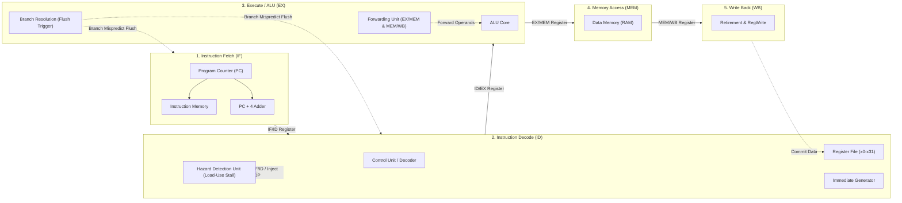
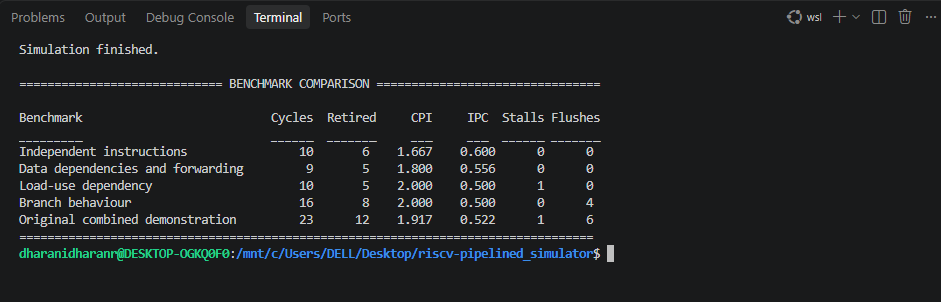

# RISC-V 5-Stage Pipeline Processor Simulator (C)

[](https://en.wikipedia.org/wiki/C_(programming_language))
[](https://en.wikipedia.org/wiki/C11_(C_standard_revision))
[](https://riscv.org/)
[](#)

A cycle-accurate, modular RISC-V (RV32I subset) 5-stage pipeline simulator written in C. It models the classic **IF (Instruction Fetch)**, **ID (Instruction Decode)**, **EX (Execute)**, **MEM (Memory Access)**, and **WB (Write Back)** stages with support for data forwarding, load-use hazard stall/interlocking, and branch misprediction flushing.

---

## Architecture Overview



---

## Key Features

- **Classic 5-Stage Pipeline Modeling**: Decoupled stage registers (`IF/ID`, `ID/EX`, `EX/MEM`, `MEM/WB`).
- **Comprehensive RV32I Subset**: `ADD`, `SUB`, `ADDI`, `LW`, `SW`, `BEQ`, `JAL`, `JALR`, `LUI`, and architectural `NOP`.
- **Hardware Hazard Resolution**:
  - **Data Forwarding**: Resolves Read-After-Write (RAW) data hazards by forwarding ALU results directly from `EX/MEM` and `MEM/WB` stages into `EX` ALU operands without stalling.
  - **Load-Use Interlocking**: Detects load-use dependencies and injects a 1-cycle architectural bubble (stall) into `ID/EX` while preserving `PC` and `IF/ID`.
  - **Branch Resolution & Flushing**: Resolves conditional branches (`BEQ`) in the `EX` stage; invalidates speculative instructions in `IF/ID` and `ID/EX` (2-cycle branch penalty) upon a taken branch.
- **Detailed Execution Analytics**:
  - Step-by-step 5-cycle pipeline timeline visualizer.
  - Performance metrics: Total Cycles, Instructions Retired, CPI (Cycles Per Instruction), and IPC (Instructions Per Cycle).
  - Hazard diagnostic counters: forwarding frequency, load-use stalls, and branch flush slots.
- **Benchmark Test Suite**: 4 targeted test programs plus a comprehensive regression suite.

---

## Project Structure

```text
.
├── include/              # Header files with struct definitions and interfaces
│   ├── cpu.h             # Register file and CPU architectural state
│   ├── instruction.h     # Instruction bitfields, opcodes, and control signals
│   ├── memory.h          # Instruction and data memory interfaces
│   ├── pipeline.h        # Pipeline registers (IF/ID, ID/EX, EX/MEM, MEM/WB)
│   └── timeline.h        # Execution visualizer definitions
├── src/                  # Modular C implementation
│   ├── alu.c             # Arithmetic Logic Unit implementation
│   ├── cpu.c             # CPU state initialization and register access
│   ├── decoder.c         # Instruction decoding and control unit signal generation
│   ├── hazards.c         # Forwarding unit and load-use hazard detection logic
│   ├── main.c            # Benchmark harness, CLI arguments, and metric reporter
│   ├── memory.c          # Memory read/write routines
│   ├── pipeline.c        # 5-stage clock cycle stepping logic
│   ├── timeline.c        # Terminal pipeline timing diagram renderer
│   └── writeback.c       # Write-back and retirement tracking
├── legacy/               # Historical monolithic implementation
│   └── pipeline.c        # Original single-file implementation for reference
├── docs/                 # Documentation and visual artifacts
│   └── images/           # Output execution screenshots
├── .gitignore            # Excludes build artifacts and binaries
└── README.md             # Project documentation
```

---

## Build & Run Instructions

### Prerequisites
- GCC / MinGW-w64 (supports C11)
- Make (optional) or any standard terminal / PowerShell

### Compilation
Compile the modular source files:
```bash
gcc -std=c11 -Wall -Wextra -O0 -Iinclude src/*.c -o pipeline.exe
```

### Running Benchmarks
Run all benchmarks and display the comparison summary table:
```bash
./pipeline.exe all
```
*(On Windows PowerShell, run `.\pipeline.exe all`)*

Run individual targeted benchmarks:
```bash
./pipeline.exe 1   # Benchmark 1: Independent instructions (Pipeline fill/drain baseline)
./pipeline.exe 2   # Benchmark 2: RAW data dependencies (EX/MEM and MEM/WB forwarding)
./pipeline.exe 3   # Benchmark 3: Load-use dependency (Stall and bubble injection)
./pipeline.exe 4   # Benchmark 4: Branch evaluation (BEQ taken, not-taken, flush verification)
./pipeline.exe 5   # Benchmark 5: Combined regression demonstration
```

---

## Benchmark Suite & Verification

| Benchmark | Focus / Hazard Scenario | Validated Behavior |
| :---: | :--- | :--- |
| **1** | **Independent Instructions** | Baseline 5-stage latency, zero stalls, ideal CPI approaching 1.0. |
| **2** | **RAW Data Hazards** | Operands forwarded through EX/MEM and MEM/WB without pipeline stalls. |
| **3** | **Load-Use Hazards** | Single-cycle interlock detected; 1 bubble inserted; instruction resumes seamlessly. |
| **4** | **Branch Resolution** | Evaluates BEQ (taken and not taken); wrong-path slots in IF/ID and ID/EX flushed. |
| **5** | **Comprehensive Regression** | Full mix of ALU, load/store, load-use stall, and control-flow instructions. |

---

## Screenshots & Visual Results

### 1. Cycle-by-Cycle Pipeline Timing Diagram
*Visualization of instructions moving across IF, ID, EX, MEM, and WB stages with stall bubbles and flushes.*


### 2. Forwarding & Hazard Interlock Demonstration
*Demonstrating operand forwarding (EX/MEM, MEM/WB) and load-use stall detection.*


### 3. Benchmark Comparison & Performance Summary
*Comprehensive table showing Cycle count, Instruction count, CPI, IPC, and Forwarding Statistics.*



---

## Performance Metrics Definition

- **CPI (Cycles Per Instruction)**: `Total Clock Cycles / Total Retired Instructions`
- **IPC (Instructions Per Cycle)**: `Total Retired Instructions / Total Clock Cycles`
- **Retirement Rule**: Instructions are counted strictly upon graduation from the **WB** stage (speculative/flushed slots do not increment retirement).
- **Ideal Reference Cycles**: Calculated as `Retired Instructions + 4` (cycles required for an ideal single-issue 5-stage pipeline without hazards).

---

## Author

- **Dharanidharan Ravikumar**
- GitHub: [@DharanidharanRavikumar](https://github.com/DharanidharanRavikumar)
- Email: [dharanidharanr12@gmail.com](mailto:dharanidharanr12@gmail.com)
